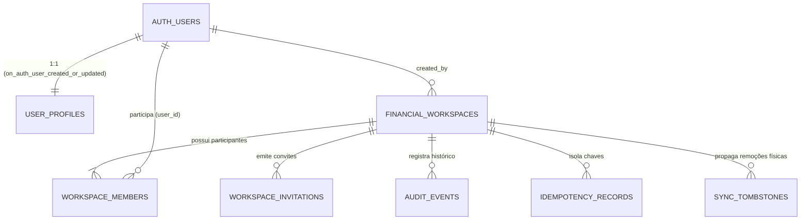

# DATABASE.md — Arquitetura de Dados PostgreSQL (Supabase)

Este documento descreve a modelagem oficial do banco de dados PostgreSQL 15+ (Supabase), a topologia das migrações, os contratos das tabelas, índices, triggers e RPCs transacionais implementadas na **Fase 1 (`T1.3A`)**.

- **Fonte Única da Verdade:** O PostgreSQL (Supabase) é a única fonte oficial do estado contábil e de controle de acesso ([AGENTS.md](./AGENTS.md) §2.1).
- **Migração Inicial:** [20261112000001_identity_workspaces_audit.sql](./supabase/migrations/20261112000001_identity_workspaces_audit.sql) *(equivalente à `00001` do Plano Mestre no formato de timestamp de 14 dígitos exigido pela Supabase CLI)*.
- **Configuração Local:** [supabase/config.toml](./supabase/config.toml).

---

## 1. Grafo de Migrações e Ordem Topológica

As migrações seguem ordem topológica estrita em `supabase/migrations/`, sem referências antecipadas a tabelas de fases futuras:

| Ordem | Arquivo | Escopo | Estado |
| :--- | :--- | :--- | :--- |
| `00001` | `20261112000001_identity_workspaces_audit.sql` | Schemas `public`/`private`, perfis, workspaces, membros, convites, idempotência, auditoria, tombstones, RLS e RPCs de onboarding/membros | **Implementada em T1.3A** *(execução em banco pendente em T1.3B)* |
| `00002` | `00002_accounts_and_categories.sql` | Contas financeiras (`financial_accounts`) e categorias hierárquicas (`categories`) | Planejada (Fase 2) |
| `00003` | `00003_transactions_transfers_backup.sql` | Lançamentos (`transactions`), alocações multicategoria (`transaction_allocations`), transferências (`transfers`) e backup/restore | Planejada (Fase 3) |
| `00004` | `00004_credit_cards_and_invoices.sql` | Cartões (`credit_cards`), faturas (`credit_card_invoices`), compras (`credit_card_purchases`), parcelas (`credit_card_installments`), estornos e pagamentos (`invoice_payments`) | Planejada (Fase 4) |
| `00005` | `00005_recurrences_and_installment_plans.sql` | Regras de recorrência (`recurrence_rules`), planos de parcelamento (`installment_plans`) e `ALTER TABLE` adicionando FKs nas tabelas das Fases 3 e 4 | Planejada (Fase 5) |
| `00006` | `00006_imports_and_reconciliation.sql` | Lotes de importação OFX/CSV (`import_batches`) e linhas conciliadas (`imported_transactions`) | Planejada (Fase 6) |

---

## 2. Separação de Schemas (`public` vs `private`)

1. **Schema `public`:**
   - Exposto ao PostgREST (`schemas = ["public", "graphql_public"]` em `supabase/config.toml`).
   - Todas as tabelas possuem `ENABLE ROW LEVEL SECURITY` e `FORCE ROW LEVEL SECURITY`.
   - Clientes (`anon`, `authenticated`) **não possuem** permissões diretas de `INSERT`, `UPDATE` ou `DELETE` nas tabelas de controle de workspace, auditoria, convites, idempotência ou tombstones; mutações ocorrem exclusivamente via RPCs transacionais validadas no servidor.
2. **Schema `private`:**
   - **Nunca exposto** ao PostgREST (`REVOKE ALL ON SCHEMA private FROM PUBLIC, anon, authenticated`).
   - Contém triggers internos e funções de segurança/auditoria (`private.assert_workspace_role`, `private.append_audit_event`, `private.acquire_idempotency_lock_and_get`, `private.tg_touch_updated_at`, `private.tg_enforce_workspace_has_active_owner`, `private.tg_protect_audit_events_immutability`).

---

## 3. Diagrama Entidade-Relacionamento (`00001`)



---

## 4. Especificação das Tabelas (`00001_identity_workspaces_audit.sql`)

### 4.1 `public.user_profiles`
Espelha os metadados públicos necessários para exibição de participantes dentro de um workspace compartilhado.

| Coluna | Tipo | Restrições | Descrição |
| :--- | :--- | :--- | :--- |
| `id` | `UUID` | `PRIMARY KEY REFERENCES auth.users(id) ON DELETE CASCADE` | Identificador idêntico ao `auth.uid()` |
| `display_name` | `TEXT` | `NOT NULL CHECK (char_length(btrim(display_name)) BETWEEN 1 AND 80)` | Nome de exibição do usuário |
| `email` | `TEXT` | `NOT NULL CHECK (email = lower(btrim(email)) AND position('@' IN email) > 1)` | E-mail normalizado em minúsculas |
| `avatar_url` | `TEXT` | `NULL CHECK (char_length(btrim(avatar_url)) BETWEEN 1 AND 512)` | URL opcional de avatar |
| `version` | `INTEGER` | `NOT NULL DEFAULT 1 CHECK (version >= 1)` | Versão para controle de concorrência otimista |
| `created_at` | `TIMESTAMPTZ` | `NOT NULL DEFAULT clock_timestamp()` | Data/hora de criação |
| `updated_at` | `TIMESTAMPTZ` | `NOT NULL DEFAULT clock_timestamp()` | Atualizado automaticamente por `private.tg_touch_updated_at()` |

- **Índices:** `idx_user_profiles_email (email)`, `idx_user_profiles_sync_cursor (updated_at ASC, id ASC)`.
- **Triggers:** `tg_user_profiles_touch_updated_at` (`BEFORE UPDATE`) e `on_auth_user_created_or_updated` (`AFTER INSERT OR UPDATE` em `auth.users`).

### 4.2 `public.financial_workspaces`
Representa um ambiente financeiro compartilhado (pessoal ou familiar).

| Coluna | Tipo | Restrições | Descrição |
| :--- | :--- | :--- | :--- |
| `id` | `UUID` | `PRIMARY KEY DEFAULT gen_random_uuid()` | Identificador único do workspace |
| `name` | `TEXT` | `NOT NULL CHECK (char_length(btrim(name)) BETWEEN 1 AND 80)` | Nome do ambiente (ex.: `"Casa Família"`) |
| `currency_code` | `TEXT` | `NOT NULL DEFAULT 'BRL' CHECK (currency_code = 'BRL')` | Moeda oficial fixa em Real Brasileiro (`BRL`) |
| `created_by` | `UUID` | `NOT NULL REFERENCES auth.users(id) ON DELETE RESTRICT` | Usuário fundador |
| `archived_at` | `TIMESTAMPTZ` | `NULL` | Preenchido apenas se o ambiente for arquivado |
| `version` | `INTEGER` | `NOT NULL DEFAULT 1 CHECK (version >= 1)` | Contador monotônico de versão |
| `created_at` | `TIMESTAMPTZ` | `NOT NULL DEFAULT clock_timestamp()` | Timestamp de criação no servidor |
| `updated_at` | `TIMESTAMPTZ` | `NOT NULL DEFAULT clock_timestamp()` | Timestamp da última mutação |

- **Índices:** `idx_financial_workspaces_created_by (created_by)`, `idx_financial_workspaces_sync_cursor (id ASC, updated_at ASC)`.
- **Invariante de Proprietário Ativo:** Protegida pelo constraint trigger deferido `tg_check_workspace_owner_on_workspace` (`DEFERRABLE INITIALLY DEFERRED`), que aborta qualquer transação que crie um workspace sem vincular exatamente 1 `owner` ativo em `public.workspace_members`.

### 4.3 `public.workspace_members`
Controla os participantes de cada workspace e seus respectivos papéis (`owner`, `editor`, `viewer`) e estados (`active`, `revoked`).

| Coluna | Tipo | Restrições | Descrição |
| :--- | :--- | :--- | :--- |
| `id` | `UUID` | `PRIMARY KEY DEFAULT gen_random_uuid()` | Identificador do vínculo |
| `workspace_id` | `UUID` | `NOT NULL REFERENCES public.financial_workspaces(id) ON DELETE CASCADE` | Workspace associado |
| `user_id` | `UUID` | `NOT NULL REFERENCES auth.users(id) ON DELETE RESTRICT` | Usuário participante |
| `role` | `TEXT` | `NOT NULL CHECK (role IN ('owner', 'editor', 'viewer'))` | Papel de permissão no workspace |
| `status` | `TEXT` | `NOT NULL DEFAULT 'active' CHECK (status IN ('active', 'revoked'))` | Estado da participação |
| `invited_by` | `UUID` | `NULL REFERENCES auth.users(id) ON DELETE SET NULL` | Quem convidou o participante |
| `joined_at` | `TIMESTAMPTZ` | `NOT NULL DEFAULT clock_timestamp()` | Data/hora de ingresso |
| `revoked_at` | `TIMESTAMPTZ` | `NULL` | Data/hora de revogação (obrigatório quando `status = 'revoked'`) |
| `revoked_by` | `UUID` | `NULL REFERENCES auth.users(id) ON DELETE SET NULL` | Usuário (`owner`) que revogou o acesso |
| `version` | `INTEGER` | `NOT NULL DEFAULT 1 CHECK (version >= 1)` | Versão para controle otimista (`p_expected_version`) |
| `created_at` | `TIMESTAMPTZ` | `NOT NULL DEFAULT clock_timestamp()` | Timestamp de criação |
| `updated_at` | `TIMESTAMPTZ` | `NOT NULL DEFAULT clock_timestamp()` | Timestamp de atualização (propaga revogações no delta-sync) |

- **Restrições e Índices Críticos:**
  - `uq_workspace_members_workspace_user UNIQUE (workspace_id, user_id)`
  - `chk_workspace_owner_cannot_be_revoked CHECK (NOT (role = 'owner' AND status = 'revoked'))`
  - `idx_workspace_single_active_owner UNIQUE ON (workspace_id) WHERE role = 'owner' AND status = 'active'` (garante **1 único proprietário ativo** por workspace).
  - `idx_workspace_members_user_active ON (user_id, workspace_id) WHERE status = 'active'` (acelera a verificação RLS `public.has_workspace_role`).
  - `idx_workspace_members_sync_cursor ON (workspace_id, updated_at ASC, id ASC)`.

### 4.4 `public.workspace_invitations`
Armazena convites emitidos pelo `owner` para novos participantes (`editor` ou `viewer`).

| Coluna | Tipo | Restrições | Descrição |
| :--- | :--- | :--- | :--- |
| `id` | `UUID` | `PRIMARY KEY DEFAULT gen_random_uuid()` | Identificador do convite |
| `workspace_id` | `UUID` | `NOT NULL REFERENCES public.financial_workspaces(id) ON DELETE CASCADE` | Workspace de destino |
| `invited_email` | `TEXT` | `NOT NULL CHECK (invited_email = lower(btrim(invited_email)) ...)` | E-mail normalizado do destinatário |
| `role` | `TEXT` | `NOT NULL CHECK (role IN ('editor', 'viewer'))` | Papel concedido ao aceitar (nunca `'owner'`) |
| `token_hash` | `TEXT` | `NOT NULL UNIQUE CHECK (token_hash ~ '^[0-9a-f]{64}$')` | Hash SHA-256 em hexadecimal do token bruto |
| `status` | `TEXT` | `NOT NULL DEFAULT 'pending' CHECK (status IN ('pending', 'accepted', 'revoked', 'expired'))` | Ciclo de vida do convite |
| `invited_by` | `UUID` | `NOT NULL REFERENCES auth.users(id) ON DELETE RESTRICT` | Proprietário que emitiu o convite |
| `accepted_by` | `UUID` | `NULL REFERENCES auth.users(id) ON DELETE SET NULL` | Usuário que aceitou o convite |
| `expires_at` | `TIMESTAMPTZ` | `NOT NULL CHECK (expires_at > created_at)` | Prazo de expiração (1 a 30 dias, padrão 7 dias) |
| `accepted_at` | `TIMESTAMPTZ` | `NULL` | Data/hora de aceitação |
| `revoked_at` | `TIMESTAMPTZ` | `NULL` | Data/hora de revogação |
| `revoked_by` | `UUID` | `NULL REFERENCES auth.users(id) ON DELETE SET NULL` | Proprietário que revogou o convite |
| `version` | `INTEGER` | `NOT NULL DEFAULT 1 CHECK (version >= 1)` | Versão do registro |
| `created_at` | `TIMESTAMPTZ` | `NOT NULL DEFAULT clock_timestamp()` | Data/hora de emissão |
| `updated_at` | `TIMESTAMPTZ` | `NOT NULL DEFAULT clock_timestamp()` | Data/hora da última transição de status |

- **Índices:** `idx_workspace_invitations_pending_email UNIQUE ON (workspace_id, invited_email) WHERE status = 'pending'`, `idx_workspace_invitations_sync_cursor ON (workspace_id, updated_at ASC, id ASC)`.

### 4.5 `public.idempotency_records`
Garante processamento exatamente-uma-vez (*idempotency*) em chamadas RPC sujeitas a retentativas de rede mobile.

| Coluna | Tipo | Restrições | Descrição |
| :--- | :--- | :--- | :--- |
| `user_id` | `UUID` | `NOT NULL REFERENCES auth.users(id) ON DELETE CASCADE` | Usuário autor da requisição |
| `idempotency_key` | `UUID` | `NOT NULL` | Chave UUID v4 gerada pelo cliente por intenção de operação |
| `workspace_id` | `UUID` | `NULL REFERENCES public.financial_workspaces(id) ON DELETE CASCADE` | Workspace alvo |
| `operation_name` | `TEXT` | `NOT NULL` | Nome da RPC (ex.: `'create_workspace_with_initial_setup'`) |
| `request_hash` | `TEXT` | `NOT NULL CHECK (request_hash ~ '^[0-9a-f]{64}$')` | Hash SHA-256 canônico dos parâmetros de entrada |
| `response_payload` | `JSONB` | `NOT NULL` | Resposta original armazenada para retorno idempotente |
| `created_at` | `TIMESTAMPTZ` | `NOT NULL DEFAULT clock_timestamp()` | Data/hora da execução original |
| `expires_at` | `TIMESTAMPTZ` | `NOT NULL DEFAULT (clock_timestamp() + INTERVAL '7 days')` | Validade do registro de idempotência |

- **Chave Primária:** `PRIMARY KEY (user_id, idempotency_key)`.

### 4.6 `public.audit_events`
Trilha de auditoria financeira e administrativa imutável (*append-only*).

| Coluna | Tipo | Restrições | Descrição |
| :--- | :--- | :--- | :--- |
| `id` | `UUID` | `PRIMARY KEY DEFAULT gen_random_uuid()` | Identificador do evento |
| `workspace_id` | `UUID` | `NOT NULL REFERENCES public.financial_workspaces(id) ON DELETE CASCADE` | Workspace ao qual o evento pertence |
| `actor_user_id` | `UUID` | `NOT NULL REFERENCES auth.users(id) ON DELETE RESTRICT` | Usuário autenticado que executou a ação |
| `entity_type` | `TEXT` | `NOT NULL` | Tipo da entidade (`financial_workspace`, `workspace_member`, etc.) |
| `entity_id` | `UUID` | `NOT NULL` | UUID do registro afetado |
| `action` | `TEXT` | `NOT NULL` | Código da ação (`workspace_created`, `workspace_member_removed`, etc.) |
| `summary_text` | `TEXT` | `NOT NULL` | Resumo legível em `pt-BR` para a tela de Histórico |
| `before_state` | `JSONB` | `NULL` | Snapshot anterior do registro (em atualizações/remoções) |
| `after_state` | `JSONB` | `NULL` | Snapshot posterior do registro |
| `created_at` | `TIMESTAMPTZ` | `NOT NULL DEFAULT clock_timestamp()` | Timestamp de gravação no servidor |

- **Proteção Append-Only:** O trigger `tg_audit_events_immutable` bloqueia qualquer `UPDATE` ou `DELETE` direto (permitindo remoção apenas em caso de `ON DELETE CASCADE` do workspace inteiro).

### 4.7 `public.sync_tombstones`
Registra exclusões físicas de registros filhos (como realocação de `transaction_allocations` a partir da Fase 3) para que clientes sincronizados via delta-sync removam linhas órfãs do SQLite local.

| Coluna | Tipo | Restrições | Descrição |
| :--- | :--- | :--- | :--- |
| `id` | `UUID` | `PRIMARY KEY DEFAULT gen_random_uuid()` | Identificador do tombstone |
| `workspace_id` | `UUID` | `NOT NULL REFERENCES public.financial_workspaces(id) ON DELETE CASCADE` | Workspace associado |
| `entity_type` | `TEXT` | `NOT NULL` | Nome lógico da entidade removida |
| `entity_id` | `UUID` | `NOT NULL` | UUID da linha física removida |
| `deleted_by` | `UUID` | `NULL REFERENCES auth.users(id) ON DELETE SET NULL` | Autor da operação |
| `deleted_at` | `TIMESTAMPTZ` | `NOT NULL DEFAULT clock_timestamp()` | Timestamp para cursor de sincronização |

- **Índice de Cursor:** `idx_sync_tombstones_cursor ON (workspace_id, deleted_at ASC, id ASC)`.

---

## 5. Catálogo de Funções e RPCs (`00001`)

| Função | Schema | Acesso Cliente | Finalidade |
| :--- | :--- | :--- | :--- |
| `has_workspace_role(p_workspace_id, p_allowed_roles)` | `public` | `authenticated` | Retorna `TRUE` se `auth.uid()` for membro `active` com um dos papéis informados em workspace não arquivado |
| `shares_active_workspace_with(p_target_user_id)` | `public` | `authenticated` | Retorna `TRUE` se `auth.uid()` for o próprio usuário ou compartilhar algum workspace ativo e não arquivado com `p_target_user_id` |
| `assert_workspace_role(p_workspace_id, p_allowed_roles)` | `private` | **Bloqueado** | Valida `auth.uid()` e participação ativa; lança `42501` (`UNAUTHENTICATED` ou `WORKSPACE_ACCESS_DENIED`) caso contrário |
| `append_audit_event(...)` | `private` | **Bloqueado** | Grava evento em `public.audit_events` validando que `p_actor_user_id = auth.uid()` |
| `acquire_idempotency_lock_and_get(...)` | `private` | **Bloqueado** | Adquire `pg_advisory_xact_lock`, verifica `public.idempotency_records` e bloqueia reutilização de chave com payload divergente (`22023`) |
| `create_workspace_with_initial_setup(p_workspace_name, p_idempotency_key)` | `public` | `authenticated` | Cria atomicamente o workspace, vincula o criador como único `owner` ativo e grava auditoria + idempotência |
| `create_workspace_invitation(p_workspace_id, p_invited_email, p_role, p_idempotency_key, p_expires_in_days)` | `public` | `authenticated` (`owner`) | Emite convite para `editor` ou `viewer`, grava apenas o `token_hash` SHA-256 e retorna `raw_token` uma única vez |
| `accept_workspace_invitation(p_raw_token, p_idempotency_key)` | `public` | `authenticated` | Valida hash do token, status, expiração e igualdade de e-mail autenticado; ativa o membro e marca o convite como `accepted` |
| `revoke_workspace_invitation(p_workspace_id, p_invitation_id, p_idempotency_key)` | `public` | `authenticated` (`owner`) | Revoga convite pendente e registra evento em `audit_events` |
| `remove_workspace_member(p_workspace_id, p_target_user_id, p_idempotency_key)` | `public` | `authenticated` (`owner`) | Revoga o acesso de um `editor` ou `viewer` (`status = 'revoked'`), proibindo remover o `owner` |
| `update_workspace_member_role(p_workspace_id, p_target_user_id, p_new_role, p_expected_version, p_idempotency_key)` | `public` | `authenticated` (`owner`) | Altera papel entre `editor` e `viewer` validando `version = p_expected_version` |
| `get_my_active_workspaces()` | `public` | `authenticated` | Lista os workspaces ativos do usuário autenticado e seu papel atual para reconexão e delta-sync |

---

## 6. Padrão de Sincronização Incremental (Keyset Pagination)

Todas as tabelas sincronizadas expõem índices compostos `(workspace_id, updated_at ASC, id ASC)` (ou `(workspace_id, deleted_at ASC, id ASC)` em `sync_tombstones`), permitindo consultas determinísticas sem perda de linhas em empates de timestamp:

```sql
SELECT *
FROM public.workspace_members
WHERE workspace_id = $1
  AND (
    updated_at > $2
    OR (updated_at = $2 AND id > $3)
  )
ORDER BY updated_at ASC, id ASC
LIMIT 500;
```